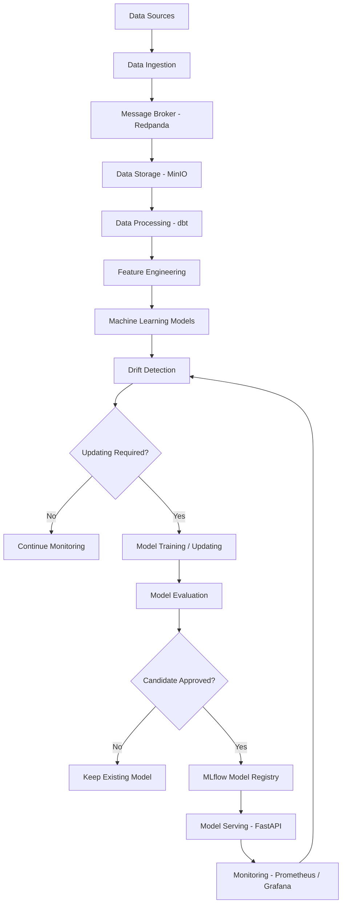

# Adaptive Model Updating in Automated Data Pipelines

## 1. Project Overview

This project focuses on researching and developing an Adaptive Model Updating system within automated data pipelines.

The main objective is to develop a system that can continuously monitor incoming data, detect changes in data distributions or underlying patterns, and update machine learning models when necessary.

Instead of relying only on periodic model retraining, the proposed system investigates adaptive updating strategies to maintain model performance as data evolves over time.

### Main Objectives

- Build an automated data ingestion and processing pipeline.
- Monitor incoming data and identify data quality issues.
- Detect Data Drift and Concept Drift.
- Investigate adaptive model updating strategies.
- Evaluate updated models against existing models.
- Manage model versions and deployment workflows.
- Monitor model performance and support rollback when necessary.

## 2. System Architecture

The proposed system consists of several interconnected components:



**Architecture Overview:**

1. Data Ingestion: Collects data from external sources.
2. Message Broker: Uses Redpanda for event streaming and message distribution.
3. Data Storage: Stores raw and processed datasets.
4. Data Processing: Transforms data and prepares machine learning features.
5. Machine Learning: Trains models and generates predictions.
6. Drift Detection: Monitors changes in incoming data and model behavior.
7. Model Updating: Trains or incrementally updates models when required.
8. Model Evaluation: Compares candidate models with existing models.
9. Model Registry: Manages model versions and experiment information.
10. Model Serving: Exposes prediction services.
11. Monitoring: Tracks system health and model performance.

The architecture represents the proposed target workflow. Components will be implemented progressively during development.

## 3. Prerequisites

Before starting development, all team members must install the following tools.

| Tool | Requirement | Purpose |
|---|---|---|
| Git | Latest stable version | Source code version control |
| Docker Desktop | Latest stable version | Running containerized services |
| Python | 3.11 | Application development and machine learning |
| Visual Studio Code | Latest stable version | Code editor and development environment |

### 3.1. Verify Installation

Verify the required tools using the following commands.

**Git**

```bash
git --version
```

**Docker**

```bash
docker --version
docker compose version
```

**Python**

```bash
python3.11 --version
```

**Visual Studio Code**

Open VS Code and verify that the editor works correctly.

### 3.2. Clone the Repository

```bash
git clone https://github.com/Nhom-4-HKDN-2026-2027/Nhom4-HKDN_2026-2027.git

cd Nhom4-HKDN_2026-2027
```

### 3.3. Set Up Python Virtual Environment

The project standardizes on Python 3.11.

Create a virtual environment:

```bash
python3.11 -m venv .venv
```

Activate the environment on macOS/Linux:

```bash
source .venv/bin/activate
```

Activate the environment on Windows:

```bash
.venv\Scripts\activate
```

Verify the Python version:

```bash
python --version
```

### 3.4. Install Development Dependencies

```bash
python -m pip install --upgrade pip

pip install -r requirements-dev.txt
```

## 4. Technology Stack

The project uses the following technologies to build an automated data pipeline and adaptive machine learning system.

### 4.1. Development and Version Control

| Technology | Purpose |
|---|---|
| Python 3.11 | Main programming language |
| Git | Source code version control |
| GitHub | Repository hosting and team collaboration |
| Visual Studio Code | Development environment |
| Ruff | Python linting and formatting |
| Pre-commit | Automated code quality checks |
| Pytest | Automated testing |

### 4.2. Data Pipeline

| Technology | Purpose |
|---|---|
| Redpanda | Kafka-compatible event streaming |
| Kafka API | Message production and consumption |
| MinIO | Object storage for datasets |
| Apache Parquet | Columnar data storage format |
| dbt | Data transformation and feature preparation |
| Apache Airflow | Workflow orchestration |

### 4.3. Machine Learning and Drift Detection

| Technology | Purpose |
|---|---|
| Pandas | Data manipulation and analysis |
| NumPy | Numerical computation |
| Scikit-learn | Machine learning algorithms and evaluation |
| River | Online and incremental machine learning |
| SciPy | Statistical analysis and hypothesis testing |

### 4.4. MLOps and Model Serving

| Technology | Purpose |
|---|---|
| MLflow | Experiment tracking and model registry |
| FastAPI | Model serving through REST APIs |
| Docker | Application containerization |
| Docker Compose | Local multi-service environment |
| GitHub Actions | Continuous integration and automation |

### 4.5. Monitoring and Infrastructure

| Technology | Purpose |
|---|---|
| OpenTelemetry | Application observability and distributed tracing |
| Prometheus | Metrics collection and monitoring |
| Grafana | Monitoring dashboards and visualization |
| Kubernetes | Container orchestration |
| Terraform | Infrastructure as Code |

**Note:** The technology stack represents the planned technical direction. Technologies will be introduced according to the implementation stages and project requirements.

## 5. Repository Structure

The repository is organized into independent modules to support parallel development and easier integration.

```text
Nhom4-HKDN_2026-2027/
│
├── .github/
│   ├── workflows/
│   │   └── ci.yml
│   └── PULL_REQUEST_TEMPLATE.md
│
├── ingest/
│   └── Data ingestion and Kafka producer/consumer
│
├── dbt/
│   └── Data transformation and feature preparation
│
├── models/
│   └── Model training and evaluation
│
├── drift/
│   └── Data drift and concept drift detection
│
├── serving/
│   └── Model serving and prediction API
│
├── infra/
│   └── Infrastructure and deployment configuration
│
├── docs/
│   └── CONTRACTS.md
│
├── data/
│   └── sample/
│
├── tests/
│   └── Automated tests
│
├── README.md
├── CONTRIBUTING.md
├── docker-compose.yml
├── pyproject.toml
├── requirements-dev.txt
├── .pre-commit-config.yaml
└── .gitignore
```

### Module Responsibilities

| Directory | Responsibility |
|---|---|
| `ingest/` | Collect and ingest data from external sources |
| `dbt/` | Transform raw data and prepare features |
| `models/` | Train, evaluate, and update machine learning models |
| `drift/` | Detect changes in data distributions and model behavior |
| `serving/` | Expose model prediction services |
| `infra/` | Manage infrastructure and deployment configurations |
| `docs/` | Store technical documentation and integration contracts |
| `data/sample/` | Store small, non-sensitive sample datasets |
| `tests/` | Store automated tests |

Each module should maintain clear interfaces and avoid unnecessary dependencies on other modules.

## 6. Development Workflow

The project follows GitHub Flow to ensure controlled collaboration and code integration.

### 6.1. Branch Strategy

- `main`: Main branch containing stable and reviewed code.
- Feature branches: Used for developing individual features or tasks.

Branch naming convention:

```text
<type>/<short-description>
```

Examples:

```text
feat/kafka-ingestion
feat/drift-detection
fix/data-validation
docs/update-readme
test/model-evaluation
chore/bootstrap-project
```

### 6.2. Development Process

1. Update the local main branch.
2. Create a feature branch.
3. Implement the assigned task.
4. Run code quality checks and tests.
5. Commit and push changes.
6. Create a Pull Request.
7. Request code review from at least one team member.
8. Resolve review comments.
9. Merge approved changes into main.

Example:

```bash
git switch main
git pull origin main

git switch -c feat/kafka-ingestion

# Implement changes

git add .
git commit -m "feat(ingest): add kafka producer"

git push -u origin feat/kafka-ingestion
```

Direct pushes to `main` should be avoided.

For detailed contribution rules, refer to `CONTRIBUTING.md`.

## 7. Code Quality and Testing

The project uses Ruff, Pre-commit, and Pytest to maintain code quality.

### 7.1. Code Linting

```bash
ruff check .
```

Automatically fix supported issues:

```bash
ruff check . --fix
```

### 7.2. Code Formatting

```bash
ruff format .
```

Check formatting without modifying files:

```bash
ruff format --check .
```

### 7.3. Automated Testing

```bash
pytest -v
```

Run tests with a concise summary:

```bash
pytest -q
```

### 7.4. Pre-commit

Install Git hooks:

```bash
pre-commit install
```

Run all configured hooks manually:

```bash
pre-commit run --all-files
```

## 8. Continuous Integration

GitHub Actions is used to automatically validate code changes.

The initial CI workflow includes:

- Python environment setup.
- Dependency installation.
- Ruff lint checks.
- Ruff formatting checks.
- Pytest execution.

CI is triggered when code is pushed to `main` or when a Pull Request targets `main`.

The purpose is to identify code quality issues and test failures before changes are integrated into the main branch.

## 9. Data and Model Management

Data and model artifacts must be managed carefully to support reproducibility and reliable model updating.

### Data Management

- Store only small, non-sensitive sample datasets in Git.
- Keep large datasets and production data outside the repository.
- Document data schemas and feature definitions.
- Preserve relevant timestamps and data provenance.
- Track dataset versions when preparing training and evaluation datasets.

### Model Management

- Record model parameters and evaluation metrics.
- Keep track of model versions and training datasets.
- Evaluate candidate models before deployment.
- Maintain the currently approved model as the production reference.
- Support rollback when an updated model fails validation or production checks.

## 10. Data and Service Contracts

The project uses shared technical contracts to define how modules communicate.

The contracts document specifies:

- Input and output data schemas.
- Message formats and topic conventions.
- Feature names and data types.
- Model input and output interfaces.
- API request and response formats.
- Infrastructure service names and connection settings.

When changing an interface between modules, the responsible team must update `docs/CONTRACTS.md` through a Pull Request and notify affected teams.

## 11. Team Collaboration

All team members are expected to:

- Follow the shared GitHub workflow.
- Work on assigned modules or tasks.
- Maintain code quality and write appropriate tests.
- Document technical changes.
- Coordinate changes that affect other modules.
- Submit contributions through Pull Requests.
- Participate in code review and integration testing.

Each member should contribute at least one reviewed and merged Pull Request as required by the initial project task.

## 12. Project Development Roadmap

The project will be implemented progressively.

| Stage | Main Activities |
|---|---|
| Stage 1 | Repository initialization and development environment setup |
| Stage 2 | Data ingestion and storage pipeline |
| Stage 3 | Data transformation and feature engineering |
| Stage 4 | Machine learning model development |
| Stage 5 | Data Drift and Concept Drift detection |
| Stage 6 | Adaptive and incremental model updating |
| Stage 7 | Model evaluation and experiment tracking |
| Stage 8 | Model serving and MLOps integration |
| Stage 9 | Monitoring, automation, and deployment |
| Stage 10 | End-to-end integration and experimental evaluation |

## 13. Documentation

Project documentation is maintained in the `docs/` directory.

Important documents:

| Document | Description |
|---|---|
| `README.md` | Project overview and setup instructions |
| `CONTRIBUTING.md` | Development and collaboration guidelines |
| `docs/CONTRACTS.md` | Data and service integration contracts |

Additional technical documentation will be added as the project evolves.
